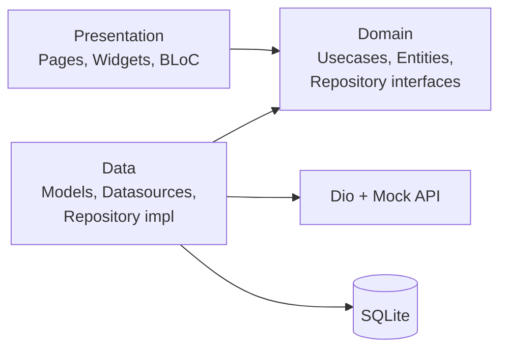
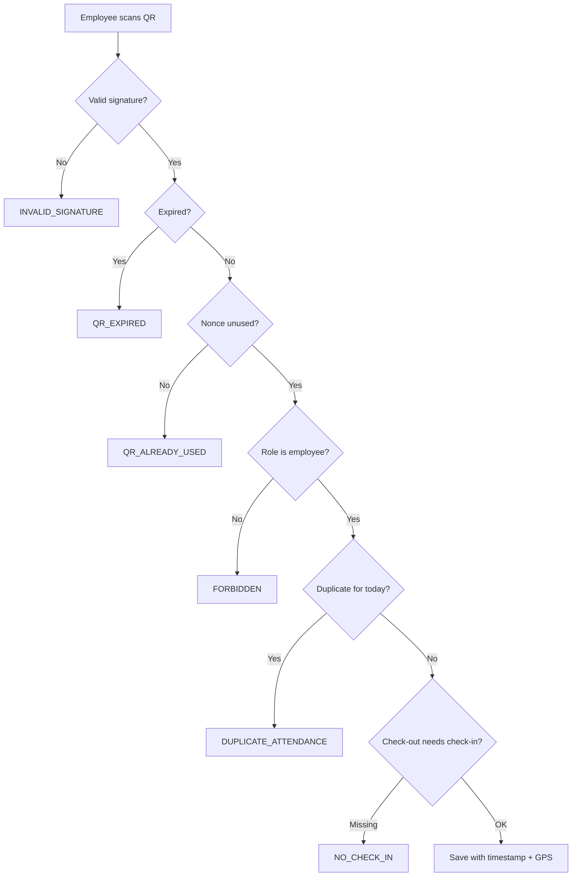

# Smart Attendance

A Flutter app that lets employees mark attendance by scanning a dynamically generated, time-limited QR code. Each QR is HMAC-signed, expires in 60 seconds and can be used only once. Check-in and check-out capture a timestamp and GPS location, and admins can view every employee's records on a dashboard.

Built with Flutter, BLoC, Clean Architecture, Dio (mock REST API) and SQLite.

## Demo

- Demo video: `<add link>`
- Screenshots: `<add images in /docs/screenshots>`

## Features

- Employee and admin login with role-based routing and secure token storage
- Admin generates a time-limited QR code (60s) with a live countdown and auto-refresh
- Employees scan the QR to check in and check out
- QR validation: signature, expiry, single-use nonce, duplicate check-in/out, check-out without check-in, and role checks
- Timestamp and GPS location captured with every attendance entry
- Individual attendance history
- Admin dashboard with summary cards, employee records and filters by date and employee
- Network failure handling, an offline banner, retry, and offline attendance that syncs when back online
- Phone portrait and tablet landscape layouts
- Light and dark themes

## Tech Stack

| Area | Choice |
|---|---|
| Framework | Flutter, Dart |
| State management | flutter_bloc (BLoC only) |
| Networking | Dio with a mock REST API interceptor |
| Local database | SQLite (sqflite) |
| QR | qr_flutter (generate), mobile_scanner (scan) |
| Location | geolocator |
| Security | crypto (HMAC-SHA256), flutter_secure_storage |
| Connectivity | connectivity_plus |
| DI | get_it |
| Testing | bloc_test, mocktail |

## Architecture

The project follows Clean Architecture with a feature-first structure. Dependencies point inward: presentation depends on domain, and data depends on domain.



```
lib/
  core/
    theme/  di/  network/  error/  responsive/  constants/
  features/
    auth/         data | domain | presentation
    qr_session/   data | domain | presentation
    attendance/   data | domain | presentation
    admin/        data | domain | presentation
  main.dart
```

**Rules followed**
- Domain is pure Dart (no Flutter, Dio or sqflite imports).
- BLoCs call usecases only, never repositories, Dio or the database directly.
- Widgets contain no business logic, hardcoded colors or hardcoded strings.

**SOLID mapping**
- **S:** each usecase and each QR validation rule has one responsibility.
- **O:** new QR rules are added as new classes without editing existing ones.
- **L:** mock and real data sources are interchangeable behind the same interfaces.
- **I:** small interfaces (AuthRepository, QrRepository, AttendanceRepository, AdminRepository).
- **D:** dependencies are abstractions injected through get_it.

## QR Validation Flow



QR payload:

```json
{
  "sessionId": "string",
  "issuedAt": 1700000000,
  "expiresAt": 1700000060,
  "nonce": "random-string",
  "signature": "hmac-sha256-hex"
}
```

## Mock REST API

The app uses Dio with a custom `MockApiInterceptor` that behaves like a REST server (600 ms latency, JSON responses, and 401/403/404/500/timeout cases). All server-side validation lives in this layer, with SQLite as the data store. Set `AppConfig.useMock = false` and change `baseUrl` to switch to a real backend. No UI or BLoC changes are needed.

| Method | Endpoint | Access | Purpose |
|---|---|---|---|
| POST | /auth/login | Public | Returns token and user |
| POST | /qr/generate | Admin | Returns a signed QR payload |
| POST | /attendance/scan | Employee | Validates the QR and saves check-in/out |
| GET | /attendance/me | Employee | Own attendance history |
| GET | /admin/attendance | Admin | All records (filters: date, employeeId) |
| GET | /admin/employees | Admin | Employee list |
| GET | /admin/summary | Admin | Dashboard counts |

Error format:

```json
{ "success": false, "code": "QR_EXPIRED", "message": "This QR code has expired." }
```

Error codes: `INVALID_SIGNATURE`, `QR_EXPIRED`, `QR_ALREADY_USED`, `DUPLICATE_ATTENDANCE`, `NO_CHECK_IN`, `UNAUTHORIZED`, `FORBIDDEN`.

## Security

- HMAC-SHA256 signed QR payloads
- 60-second expiry and single-use nonce
- Role-based access checks on every endpoint
- Auth token stored in flutter_secure_storage
- A 401 response forces logout
- Input validation, and no sensitive data in logs

## Getting Started

**Prerequisites:** Flutter SDK (stable), Android Studio or Xcode, an emulator or device.

```bash
git clone https://github.com/Paul91810/smart-attendance-flutter.git
cd smart-attendance-flutter
flutter pub get
flutter run
```

Run the tests and static analysis:

```bash
flutter analyze
flutter test
```

**Permissions:** the app needs camera access (scanning) and location access (GPS). Allow both on first launch.

**Emulator note:** emulators can't scan a live QR. Use the debug-only "Simulate scan" button, which uses the latest generated QR.

## Demo Credentials

| Role | Email | Password |
|---|---|---|
| Admin | `<admin email>` | `<password>` |
| Employee | `<employee email>` | `<password>` |

Dummy data: 1 admin and 5 employees (EMP001 to EMP005). Replace the placeholders with the seeded values.

## Assumptions

- A mock REST API is used, as allowed by the assessment, with SQLite for persistence.
- One check-in and one check-out per employee per day.
- The QR secret is kept in a constant for this demo. In production it would live only on the server.

## Future Improvements

- Replace the mock layer with a real backend and server-side validation
- Geofencing to restrict attendance to office locations
- Biometric confirmation on check-in
- Push notifications and reports export (CSV/PDF)
- Multi-office and shift support

## Author

**Paul Pius**, Flutter Developer
[GitHub](https://github.com/Paul91810) · [LinkedIn](https://linkedin.com/in/paul91810)