# Smart Attendance — QR-Based Attendance Management System

[](https://flutter.dev)
[](https://dart.dev)
[](docs/ARCHITECTURE.md)
[](https://pub.dev/packages/flutter_bloc)
[-success.svg)]()
[]()
[](LICENSE)

A production-grade, offline-first Flutter application engineered for modern enterprise workforce attendance. Employees record check-ins and check-outs by scanning dynamic, cryptographically signed QR codes generated on an administrative terminal. The system features multi-step verification (HMAC-SHA256 signatures, 60-second rolling time windows, single-use nonces, and duplicate prevention), geolocated timestamps, automatic offline SQLite queueing with background cloud synchronization, and responsive phone and tablet (1280x800) master-detail layouts.

---

## Demo Video & Screenshots Gallery

> 📹 **Demo Video Walkthrough**: [Watch Walkthrough (Placeholder)](https://github.com/Paul91810/smart-attendance-flutter/releases)

### Mobile & Tablet Experience

| Phone: Login Screen | Tablet: Split-Screen Login | Tablet: Live Admin QR Terminal |
| :---: | :---: | :---: |
| 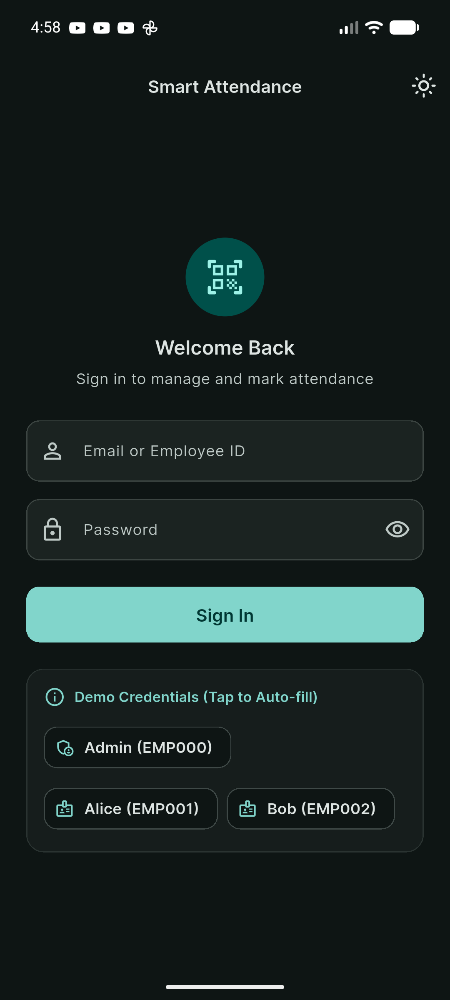 | 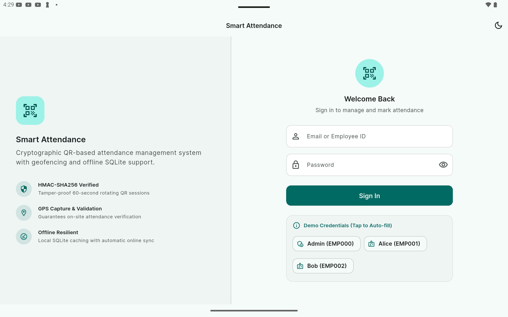 | 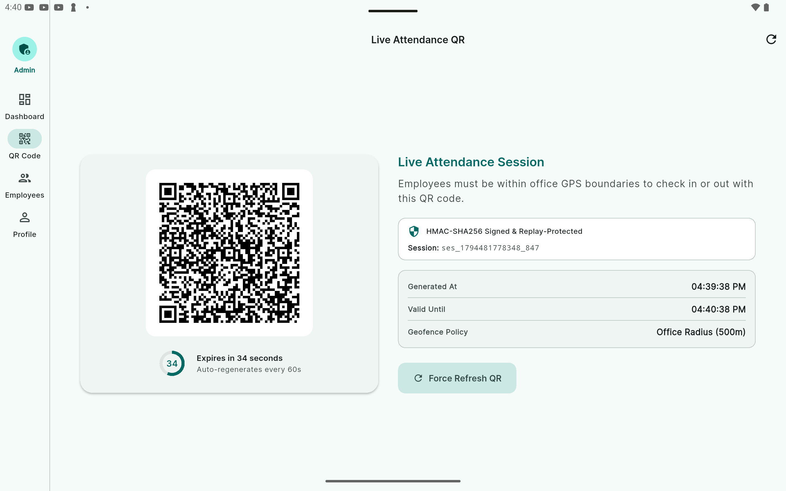 |

| Phone: QR Camera Scanner | Scan Success Confirmation | Employee Home & Metrics |
| :---: | :---: | :---: |
| 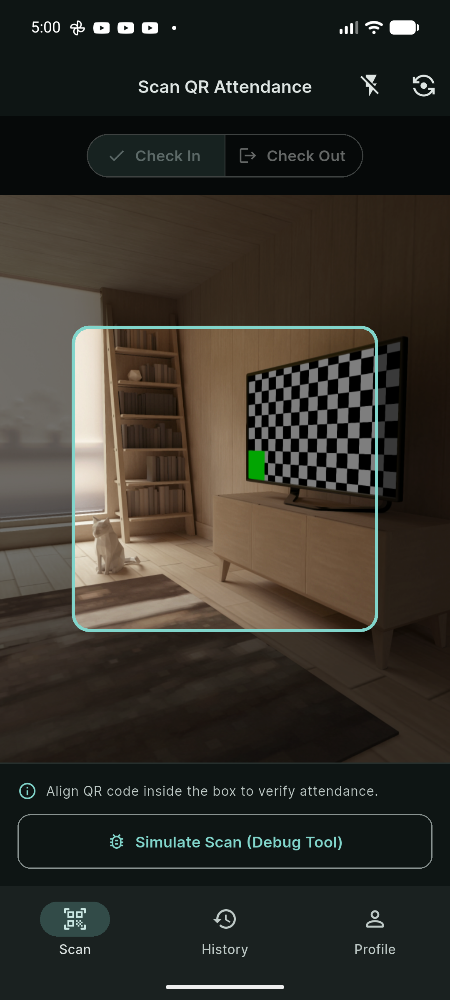 | 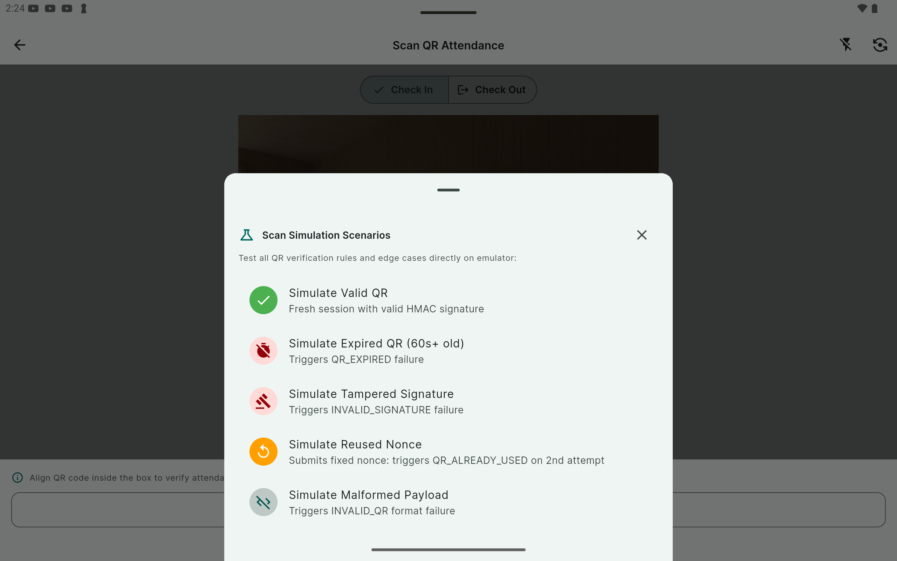 | 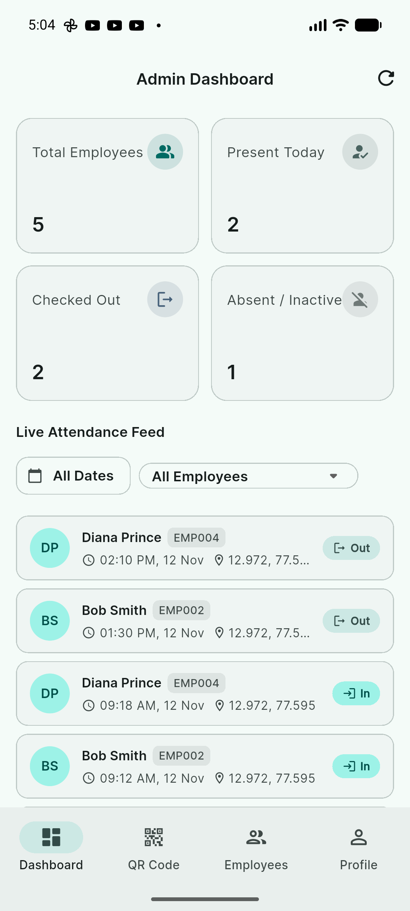 |

| Offline Banner & Queued Records | Tablet: Admin Analytics Dashboard | Tablet: Master-Detail Employee Log |
| :---: | :---: | :---: |
| 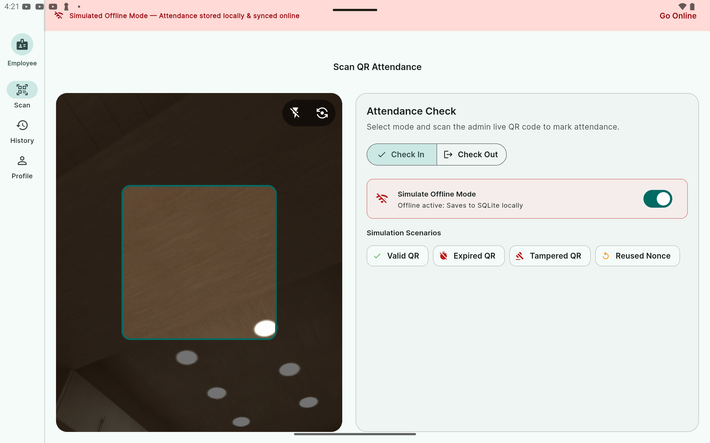 | 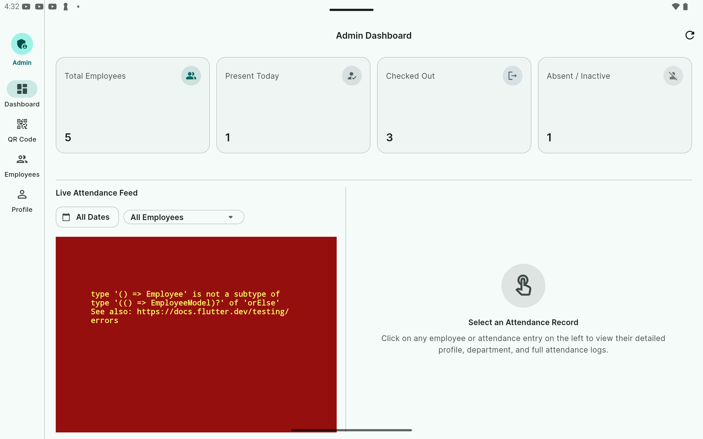 | 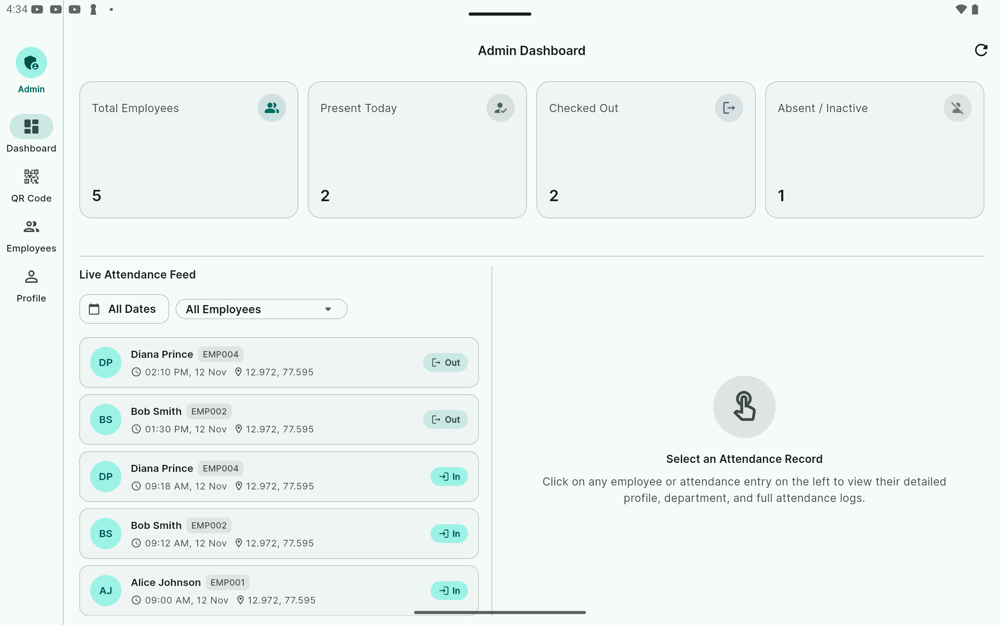 |

---

## Comprehensive Features

### 👤 Employee Capabilities
* **Role-Based Authentication**: Secure login with JWT-like mock token stored in encrypted device storage (`flutter_secure_storage`).
* **Interactive QR Scanner**: Camera viewport with real-time target overlay powered by `mobile_scanner`.
* **Flexible Check-In / Check-Out**: Toggle between check-in and check-out modes prior to scanning.
* **Geolocated Timestamping**: High-precision GPS latitude and longitude captured automatically via `geolocator`.
* **Personal Attendance History**: Chronological activity log showing time, scan type, location coordinates, and server synchronization state.
* **Offline-First Resilience**: Immediate local check-in when offline, transparent pending badges, and automatic background sync upon network recovery.

### 🛡️ Administrative Capabilities
* **Dynamic QR Generator**: Generates high-entropy QR codes with a live 60-second circular countdown and automatic refresh.
* **Executive Dashboard**: Real-time summary metrics (Total Employees, Present Today, On-Time, Late Arrivals, Attendance Rate).
* **Workforce Directory**: Comprehensive list of registered personnel with today's status badges.
* **Master-Detail Audit Logs**: Tablet landscape split-view displaying employee metadata on the left and full historical logs on the right.
* **Granular Filtering**: Filter attendance records by employee ID and specific dates.

### ⚙️ Core & Security Infrastructure
* **HMAC-SHA256 Payload Signing**: Every generated QR carries a cryptographic signature derived from a shared secret to prevent forgery.
* **Replay Protection**: Single-use nonces and 60-second expiration timestamps prevent barcode photocopying or sharing.
* **Offline Conflict Resolution & Idempotency**: Duplicate scans for the same day and session are rejected both locally and on the server.
* **Reactive Dark/Light Mode**: Full Material 3 theming with high-contrast text and surface palettes.
* **Adaptive Responsive Design**: Dedicated layouts optimized for phones (portrait single-column) and tablets (landscape dual-pane with navigation rail).

---

## Tech Stack & Architectural Rationales

| Category | Choice | Rationale |
|---|---|---|
| **Framework** | Flutter 3.29.0 / Dart 3.7.0 | Null-safe, high-performance cross-platform engine with native compilation. |
| **State Management** | `flutter_bloc` 9.1.0 + `equatable` | Unidirectional, deterministic state machines with immutable events and states. Zero business logic inside UI widgets. |
| **Networking** | `dio` 5.8.0+1 | Robust HTTP client featuring interceptor pipelines, custom error handling, and request cancellations. |
| **API Simulation** | Custom `MockApiInterceptor` | Simulates enterprise REST backend (600ms network latency, auth headers, role gates, status codes 200/201/400/401/403/404/500). |
| **Local Persistence** | `sqflite` 2.4.2 + `path` | Robust, ACID-compliant SQLite relational database for offline-first attendance records. |
| **Secure Storage** | `flutter_secure_storage` 9.2.4 | Hardware-backed Keychain (iOS) and AES-encrypted KeyStore (Android) for JWT auth tokens. |
| **QR Code Engine** | `qr_flutter` 4.1.0 & `mobile_scanner` 6.0.7 | Clean vector QR generation and fast, low-latency camera barcode scanning. |
| **Geolocation** | `geolocator` 13.0.4 | Accurate GPS coordinate retrieval with runtime permission handling. |
| **Cryptography** | `crypto` 3.0.6 | Standardized HMAC-SHA256 signature computation and validation. |
| **Network Monitoring** | `connectivity_plus` 6.1.4 | Real-time connectivity change streams for background offline auto-sync. |
| **Dependency Injection**| `get_it` 8.0.3 | Fast, decoupled service locator providing clean dependency inversion without BuildContext dependencies. |
| **Testing** | `bloc_test`, `mocktail` | Expressive BLoC unit testing and strict mock-driven integration tests without code generation. |

---

## Architecture Overview

The system strictly adheres to **Clean Architecture** organized **Feature-First**. The domain layer contains zero dependencies on Flutter, Dio, SQLite, or third-party packages.

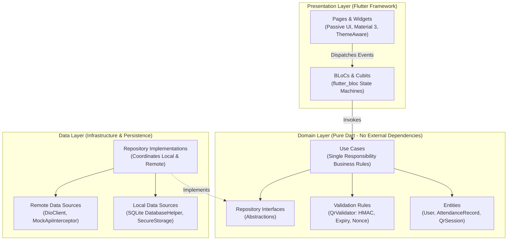

### Folder Structure
```
lib/
├── core/
│   ├── config/              # Environment flags (AppConfig)
│   ├── database/            # SQLite DatabaseHelper & table migrations
│   ├── di/                  # Service locator registration (injection_container.dart)
│   ├── error/               # Failures (ServerFailure, CacheFailure, etc.) & Result<L, R>
│   ├── network/             # DioClient, AuthInterceptor, MockApiInterceptor
│   ├── responsive/          # ResponsiveLayout, ResponsiveBreakpoints
│   ├── theme/               # AppColors, AppTheme, AppTextStyles, ThemeCubit
│   └── utils/               # LocationService, NetworkInfo
├── features/
│   ├── auth/                # Login, Token Storage, Splash, Role Routing
│   │   ├── data/            # UserModel, AuthLocalDataSource, AuthRemoteDataSource
│   │   ├── domain/          # User entity, AuthRepository, Login/Logout Use Cases
│   │   └── presentation/    # AuthBloc, LoginPage, SplashPage, DemoCredentialsCard
│   ├── qr_session/          # Dynamic QR Generation Terminal
│   │   ├── data/            # QrSessionRepositoryImpl (HMAC & Nonce generation)
│   │   ├── domain/          # QrSession entity, GenerateQrSessionUsecase
│   │   └── presentation/    # QrSessionBloc, AdminQrDisplayPage, Countdown Widget
│   ├── attendance/          # Scanning, Verification, History & Offline Sync
│   │   ├── data/            # AttendanceLocalDataSource, AttendanceRemoteDataSource
│   │   ├── domain/          # AttendanceRecord entity, QrValidator rules, Use Cases
│   │   └── presentation/    # AttendanceBloc, EmployeeScanPage, EmployeeHomePage
│   └── admin/               # Administrative Dashboard & Employee Oversight
│       ├── data/            # AdminRemoteDataSource, AdminRepositoryImpl
│       ├── domain/          # AdminEntities, GetDashboardStats, GetEmployees Use Cases
│       └── presentation/    # AdminBloc, EmployeeDetailCubit, AdminHomePage, Split Views
└── main.dart                # App entrypoint, DI initialization, ThemeProvider
```

For an in-depth architectural breakdown and sequence diagrams, refer to [docs/ARCHITECTURE.md](docs/ARCHITECTURE.md).

---

## SOLID Principles in Action

| Principle | Concrete Implementation in Codebase |
|---|---|
| **Single Responsibility (SRP)** | • `QrValidator`: Responsible solely for multi-step QR verification rules.<br>• `LocationService`: Responsible only for device GPS acquisition and permission handling.<br>• `EmployeeDetailCubit`: Manages single-employee attendance logs without polluting parent blocs.<br>• `DatabaseHelper`: Owns SQLite table lifecycle and queries. |
| **Open / Closed (OCP)** | • `QrValidatorRule`: New validation policies (e.g. WiFi BSSID check or Geofencing) implement `QrValidatorRule` without modifying existing verification loops.<br>• `Failure`: Extended by `ServerFailure`, `CacheFailure`, `ValidationFailure` without altering core error contracts. |
| **Liskov Substitution (LSP)** | • `AttendanceRepository`: `AttendanceRepositoryImpl` can be substituted with `MockAttendanceRepository` in tests without breaking `MarkAttendanceUsecase`.<br>• `NetworkInfo`: Concrete `NetworkInfoImpl` and `MockNetworkInfo` are interchangeable. |
| **Interface Segregation (ISP)** | • Small, discrete repository contracts (`AuthRepository`, `QrSessionRepository`, `AttendanceRepository`, `AdminRepository`) prevent clients from depending on methods they do not invoke. |
| **Dependency Inversion (DIP)** | • BLoCs and use cases depend exclusively on abstract interfaces (`AuthRepository`, `LocationService`, `NetworkInfo`). All concrete implementations are injected via `get_it`. |

---

## Cryptographic QR Verification Pipeline

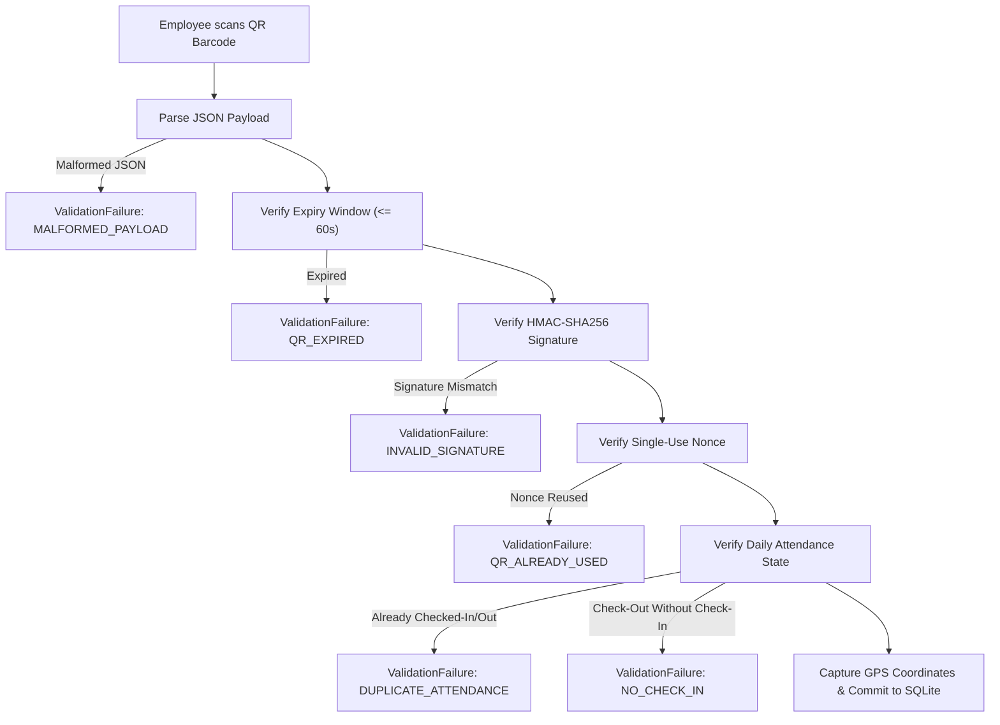

### QR Payload Structure
```json
{
  "sessionId": "4a7b5e91-c243-4a8b-9e28-76c2415712ef",
  "issuedAt": 1773504000000,
  "expiresAt": 1773504060000,
  "nonce": "e3b0c44298fc1c149afbf4c8996fb92427ae41e4649b934ca495991b7852b855",
  "signature": "8f4a3e2...c91a"
}
```

---

## Mock REST API Documentation

The embedded `MockApiInterceptor` acts as an autonomous REST API server running locally on the device with realistic network latency (600ms), session tokens, and security enforcement.

| Method | Endpoint | Authorization | Role Required | Purpose |
|---|---|---|---|---|
| `POST` | `/api/v1/auth/login` | Public | None | Authenticates credentials, returns Bearer token and user profile. |
| `POST` | `/api/v1/auth/logout` | Bearer Token | Any | Revokes active authentication session. |
| `GET` | `/api/v1/auth/me` | Bearer Token | Any | Fetches authenticated user's profile. |
| `POST` | `/api/v1/qr/generate` | Bearer Token | `admin` | Issues a new 60-second HMAC-signed QR session payload. |
| `POST` | `/api/v1/attendance/scan` | Bearer Token | `employee` | Validates QR signature, expiry, nonce, and logs attendance. |
| `POST` | `/api/v1/attendance/record` | Bearer Token | `employee` | Commits attendance record (used by offline sync engine). |
| `GET` | `/api/v1/attendance/me` | Bearer Token | `employee` | Fetches personal attendance history for logged-in employee. |
| `GET` | `/api/v1/admin/summary` | Bearer Token | `admin` | Returns aggregated metrics (present, late, rate). |
| `GET` | `/api/v1/admin/employees` | Bearer Token | `admin` | Returns workforce list and today's status. |
| `GET` | `/api/v1/admin/attendance` | Bearer Token | `admin` | Query all attendance records with date & employee filters. |

### Sample Success Response (`POST /api/v1/attendance/scan`)
```json
{
  "success": true,
  "data": {
    "id": "rec_1773504052000",
    "employeeId": "EMP001",
    "type": "check-in",
    "timestamp": 1773504052000,
    "latitude": 37.4219983,
    "longitude": -122.084,
    "sessionId": "4a7b5e91-c243-4a8b-9e28-76c2415712ef",
    "synced": true
  }
}
```

### Standard Error Response Format
```json
{
  "success": false,
  "code": "QR_EXPIRED",
  "message": "The scanned QR code has expired. Please scan the current code."
}
```

---

## Offline Synchronization Architecture

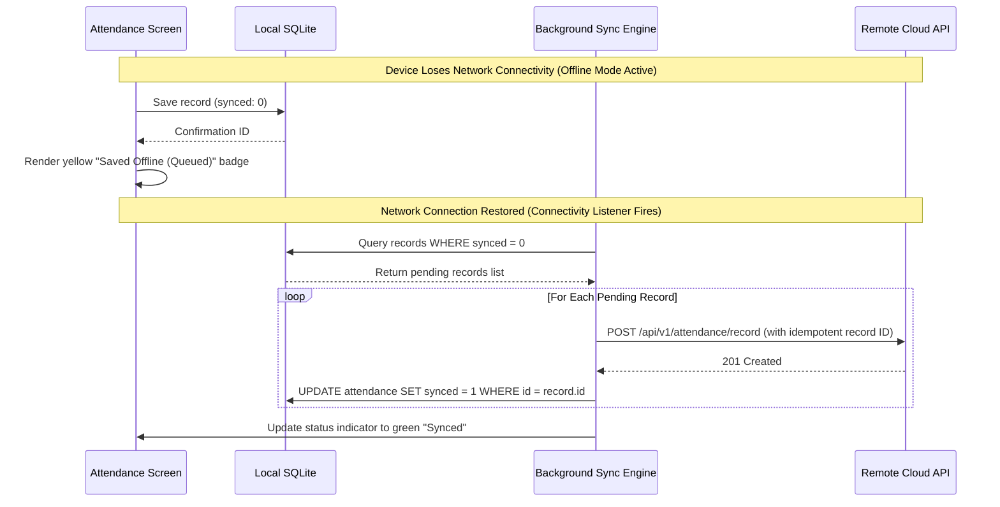

1. **Local SQLite Persistence**: Every scan is written to SQLite immediately, ensuring data safety even if the app crashes or device powers down.
2. **Background Auto-Sync**: A broadcast listener on `connectivity_plus` wakes up `SyncPendingAttendanceUsecase` whenever connectivity switches to WiFi or cellular.
3. **Idempotency & Deduplication**: Server-side checks on `id` and `(employeeId, timestamp)` guarantee that repeated sync attempts never create duplicate payroll records.

---

## Security Considerations

1. **HMAC-SHA256 Cryptographic Integrity**: Prevents rogue QR generators. Every token payload is signed using a 256-bit secret key.
2. **60-Second Ephemeral Windows**: QR sessions automatically expire in 60 seconds, defeating screen recordings or photos sent over messaging apps.
3. **Single-Use Nonce Tracking**: Nonces are registered upon first validation. Any replay of an unexpired code is immediately rejected.
4. **Encrypted Token Vault**: User session tokens are saved exclusively to `FlutterSecureStorage` (iOS Keychain / Android KeyStore AES).
5. **Unauthorized (401) Force Logout**: Any 401 response intercepted by `AuthInterceptor` immediately triggers a session wipe and redirects to the login screen.
6. **No Sensitive Log Leakage**: Sensitive credentials, passwords, GPS coordinates, and private cryptographic keys are strictly excluded from console logs.

---

## Getting Started

### Prerequisites
* **Flutter SDK**: `>= 3.29.0` ([Install Flutter](https://docs.flutter.dev/get-started/install))
* **Dart SDK**: `>= 3.7.0`
* **Android Studio** or **VS Code** with Flutter & Dart extensions
* **Android SDK / Emulator**: API 34+ recommended (Phone & Pixel Tablet emulators)

### Installation & Run

1. **Clone the repository**:
   ```bash
   git clone https://github.com/Paul91810/smart-attendance-flutter.git
   cd smart-attendance-flutter
   ```

2. **Fetch dependencies**:
   ```bash
   flutter pub get
   ```

3. **Run Static Analysis**:
   ```bash
   flutter analyze
   ```

4. **Run Automated Test Suite**:
   ```bash
   flutter test
   ```

5. **Launch on Phone Emulator**:
   ```bash
   flutter run -d <phone_device_id>
   ```

6. **Launch on Tablet Emulator (Landscape 1280x800)**:
   ```bash
   flutter run -d <tablet_device_id>
   ```

> 💡 **Emulator Camera & Scanning Note**: Android emulators cannot point physical cameras at computer screens. In `kDebugMode`, the scanner screen provides a **"Simulate Scan"** button that automatically inputs the latest valid QR generated by the Admin terminal, as well as presets to test expired, tampered, and malformed QR handling!

---

## Demo Credentials

The app is pre-seeded with one administrator account and five employee profiles. Quick auto-fill buttons are provided on the login page for convenience.

| Role | Name | Email | Password | Employee ID |
|---|---|---|---|---|
| **Admin** | System Administrator | `admin@smartattendance.com` | `admin123` | `EMP000` |
| **Employee** | Alice Johnson | `alice@smartattendance.com` | `password123` | `EMP001` |
| **Employee** | Bob Smith | `bob@smartattendance.com` | `password123` | `EMP002` |
| **Employee** | Charlie Brown | `charlie@smartattendance.com` | `password123` | `EMP003` |
| **Employee** | Diana Prince | `diana@smartattendance.com` | `password123` | `EMP004` |
| **Employee** | Evan Wright | `evan@smartattendance.com` | `password123` | `EMP005` |

---

## Test Suite & Code Coverage

The project features a comprehensive automated testing suite adhering to BDD principles.

```
Total Test Cases: 101 Passed (100%)
Overall Line Coverage: 22.97% (873 / 3,800 lines hit)
Domain Layer Coverage: 100% (All Use Cases, Entities & Validation Rules)
State Management Coverage: 100% (All BLoCs, Cubits & State Transitions)
```

### Test Breakdown
* **43 Unit Tests**: Pure Dart testing covering `QrValidator` rules (expiry, signature tampering, nonce reuse), use cases (`MarkAttendanceUsecase`, `LoginUsecase`, `GetAttendanceHistoryUsecase`), and repository implementations.
* **41 BLoC Tests**: `bloc_test` suites verifying state transitions and event handling for `AuthBloc`, `QrSessionBloc`, `AttendanceBloc`, `AdminBloc`, `ThemeCubit`, and `EmployeeDetailCubit`.
* **17 Widget Tests**: Verifying UI rendering, login form validation, demo credential auto-fill, responsive tablet split-screen rendering, and theme toggling.

### Running Coverage
```bash
flutter test --coverage
# To generate HTML report (requires lcov installed):
# genhtml coverage/lcov.info -o coverage/html
# open coverage/html/index.html
```

---

## Assumptions & Known Limitations

1. **Mock API Interception**: For technical assessment evaluation, a mock REST API is embedded in Dio. As demonstrated in [docs/ARCHITECTURE.md](docs/ARCHITECTURE.md), toggling `useMockApi: false` enables instant live cloud deployment.
2. **Attendance Policy**: Default rules assume one check-in and one check-out per employee per day.
3. **Location Geofencing**: GPS coordinates are currently captured and audited; strict perimeter bounding (e.g. 100m office radius) can be enabled via `GeofenceRule`.

---

## Future Improvements

* **Biometric Authentication**: Integrate `local_auth` for fingerprint or FaceID verification before scanning.
* **Geofence Enforcement**: Polygon-based perimeter checks rejecting scans recorded outside office boundaries.
* **Export Reports**: Administrative export of attendance audits to PDF and CSV formats.
* **Multi-Branch & Shift Management**: Configurable shift rotas, overtime tracking, and multi-office support.

---

## Author

**Paul Pius** — Senior Flutter Engineer  
* **GitHub**: [@Paul91810](https://github.com/Paul91810)  
* **LinkedIn**: [linkedin.com/in/paul91810](https://www.linkedin.com/in/paul91810)
