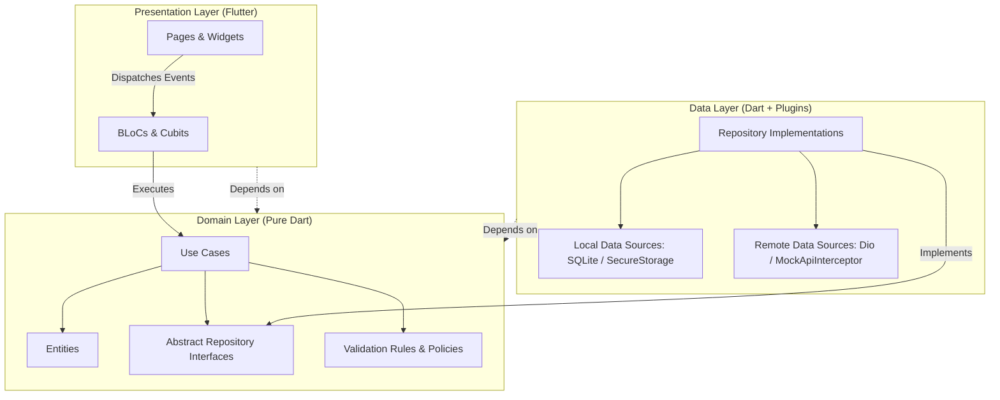
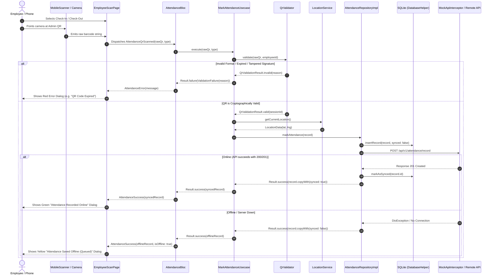

# Smart Attendance — Architecture & Technical Design Document

This document provides a comprehensive technical deep-dive into the architecture, design decisions, data flows, and migration pathways of the **Smart QR-Based Attendance Management System**.

---

## 1. Architectural Philosophy: Clean Architecture & SOLID

The application strictly adheres to Uncle Bob's **Clean Architecture** combined with **Feature-First modularization**.



### The Dependency Rule
- **Inner layers have zero knowledge of outer layers.**
- `features/<feature>/domain` is **100% pure Dart**:
  - No `package:flutter`
  - No `package:dio`
  - No `package:sqflite`
  - No data models or JSON serialization logic.
- Presentation communicates with the domain **exclusively through Use Cases**. BLoCs never call repositories, data sources, or network clients directly.
- All use cases return a functional `Result<Failure, T>` object, enforcing explicit and exhaustive error handling across every layer without unhandled exceptions.

---

## 2. Architectural Decision Records (ADRs)

### ADR-001: Pure Dart Domain with Dependency Inversion
* **Status**: Accepted
* **Context**: Cross-platform Flutter apps frequently tangle UI logic, network parsing, and persistence models into business rules, making automated testing difficult and coupling the app to specific third-party plugins.
* **Decision**: We isolated all enterprise business logic into pure Dart entities, repository interfaces, and use cases. Concrete implementations (SQLite, Dio, Geolocator, MobileScanner) reside strictly in the `data` and `core` layers and are bound at startup using `get_it`.
* **Consequences**:
  - Domain tests run instantly in pure Dart without Flutter test binding overhead.
  - Storage engine or network client can be completely swapped without modifying business rules.

### ADR-002: flutter_bloc with Equatable for Deterministic State Machines
* **Status**: Accepted
* **Context**: Attendance marking, countdown timers, offline syncing, and role management require predictable, unidirectional data flows that eliminate race conditions and unexpected rebuilds.
* **Decision**: We standardized on `flutter_bloc` exclusively. Every UI interaction dispatches an immutable `Equatable` event, and every screen reacts to an immutable `Equatable` state.
* **Consequences**:
  - UI components remain passive renderers without embedded business logic.
  - Eliminates `setState` for business operations.
  - Complete traceability of state transitions with `BlocObserver`.

### ADR-003: Cryptographic QR Sessions (HMAC-SHA256 & Nonce Prevention)
* **Status**: Accepted
* **Context**: Traditional static QR codes can be photographed, forwarded, or printed, allowing employees to mark attendance fraudulently off-site.
* **Decision**:
  1. The Admin terminal generates a dynamic session containing `sessionId`, `timestamp`, `nonce`, and an `HMAC-SHA256` signature.
  2. The QR rotates automatically every 60 seconds with a real-time countdown progress bar.
  3. The scanning client and server validate:
     - JSON structure validity.
     - Timestamp age ($\le 60\text{ seconds}$).
     - HMAC signature match against shared secret (`attendance_super_secret_key_2026`).
     - Single-use `nonce` verification to reject duplicate scans.
* **Consequences**:
  - Eliminates replay attacks and static QR sharing.
  - Scans can still be verified offline locally before queuing for cloud sync.

### ADR-004: Offline-First Architecture with SQLite & Connectivity-Aware Auto-Sync
* **Status**: Accepted
* **Context**: Employees in basements, warehouses, or remote worksites frequently experience intermittent or absent network connectivity.
* **Decision**:
  1. All attendance records are saved immediately to local SQLite (`synced = 0` if offline, `synced = 1` if online).
  2. The employee receives an immediate green confirmation indicating offline local queueing.
  3. `NetworkInfo` monitors connectivity changes using `connectivity_plus`.
  4. Upon network restoration, `AttendanceBloc` triggers `SyncPendingAttendanceUsecase`, flushing pending records to the backend with exponential backoff and idempotency protection.
* **Consequences**:
  - Zero lost scans due to spotty WiFi or cellular dead zones.
  - Transparent pending status indicators on employee history cards.

### ADR-005: MockApiInterceptor Simulation Engine & Seamless Production Migration
* **Status**: Accepted
* **Context**: Technical assessments and sandboxed evaluations require realistic REST simulation (latency, 401s, 403s, 500s, role authorization) without external server dependencies.
* **Decision**: A custom Dio `MockApiInterceptor` intercepts requests to `/api/v1/*`, validates JWT Bearer tokens, enforces role-based access, and maintains an in-memory seed store. A debug simulation drawer enables toggling artificial 500 errors and network failures.
* **Consequences**:
  - Fully functional standalone demo on any device or emulator.
  - Zero changes to business logic or UI when swapping to a real cloud backend (see [Section 5](#5-production-migration-guide)).

---

## 3. Layer-by-Layer Breakdown

### `core/` — Infrastructure & Shared Primitives
* **`core/error/`**: Defines `Failure` hierarchy (`ServerFailure`, `CacheFailure`, `AuthFailure`, `ValidationFailure`, `LocationFailure`) and `Result<Failure, T>` functional error container with `.fold()`.
* **`core/network/`**:
  - `DioClient`: Configured Dio instance with timeouts, logging, and interceptor chains.
  - `AuthInterceptor`: Attaches `Authorization: Bearer <token>` from `FlutterSecureStorage` and handles 401 token invalidation.
  - `MockApiInterceptor`: In-memory REST server simulation.
* **`core/database/`**:
  - `DatabaseHelper`: SQLite database initialization (`smart_attendance.db`) managing the `attendance` table.
* **`core/di/`**:
  - `injection_container.dart`: Service locator configuration with `GetIt.instance`.
* **`core/responsive/`**:
  - `ResponsiveLayout`: Dispatches between `phone` and `tablet` builders based on `ResponsiveBreakpoints` (600dp breakpoint).
* **`core/theme/`**:
  - `AppColors`, `AppTheme`, `AppTextStyles`: Material 3 design system supporting dynamic Light and Dark mode switching managed by `ThemeCubit`.

### `features/auth/` — Identity & Access Control
* **Domain**:
  - Entity: `User` (`id`, `employeeId`, `name`, `email`, `role`).
  - Usecases: `LoginUsecase`, `LogoutUsecase`, `CheckAuthStatusUsecase`, `GetCurrentUserUsecase`.
* **Data**:
  - `UserModel`: JSON serialization and mapping.
  - `AuthLocalDataSource`: Reads/writes tokens and user profiles in `FlutterSecureStorage`.
  - `AuthRemoteDataSource`: Authenticates against `/api/v1/auth/login`.
  - `AuthRepositoryImpl`: Coordinates token caching and remote validation.
* **Presentation**:
  - `AuthBloc`: Emits `AuthInitial`, `AuthLoading`, `Authenticated(user)`, `Unauthenticated`, `AuthFailureState`.
  - `LoginPage`: Form validation, demo credential auto-fill buttons, responsive single-column (phone) vs. two-column branding/form (tablet) layout.
  - `SplashPage`: Startup token verification and auto-routing.

### `features/qr_session/` — Rotating Dynamic Token Generator
* **Domain**:
  - Entity: `QrSession` (`sessionId`, `timestamp`, `nonce`, `signature`, `qrPayload`).
  - Usecase: `GenerateQrSessionUsecase`.
* **Data**:
  - `QrSessionRepositoryImpl`: Generates unique nonces (`UUIDv4`), computes HMAC-SHA256 signatures using `crypto`, and formats serialized JSON payloads.
* **Presentation**:
  - `QrSessionBloc`: Manages 60-second ticker timer, emits `QrSessionTicking(session, secondsRemaining)` and automatically regenerates sessions upon expiry.
  - `AdminQrDisplayPage`: High-contrast QR renderer with live circular countdown timer and manual regenerate button.

### `features/attendance/` — Scanner, Validation & Offline Logging
* **Domain**:
  - Entity: `AttendanceRecord` (`id`, `employeeId`, `type`, `timestamp`, `latitude`, `longitude`, `sessionId`, `synced`).
  - Entity: `QrValidationResult` (`isValid`, `failureReason`, `sessionId`).
  - Rules: `QrValidator` enforcing:
    1. Valid JSON format.
    2. Payload expiration check ($\le 60\text{s}$).
    3. HMAC-SHA256 signature verification.
    4. Nonce reuse prevention.
  - Usecases: `MarkAttendanceUsecase`, `GetAttendanceHistoryUsecase`, `SyncPendingAttendanceUsecase`.
* **Data**:
  - `AttendanceLocalDataSource`: SQLite CRUD operations (`insertRecord`, `getHistory`, `getUnsyncedRecords`, `markAsSynced`).
  - `AttendanceRemoteDataSource`: Calls `POST /api/v1/attendance/record` and `POST /api/v1/attendance/sync`.
  - `AttendanceRepositoryImpl`: Implements offline-first caching, local fallback validation, and automatic server synchronization.
* **Presentation**:
  - `AttendanceBloc`: Emits scanning progress, validation failures, success dialog events, and pending sync counts.
  - `EmployeeScanPage`: Integrates `mobile_scanner` with overlay viewfinder, check-in / check-out mode selector, and debug scan simulation modal.
  - `EmployeeHomePage`: Header metrics, quick scan actions, offline banner, and history list.

### `features/admin/` — Oversight & Live Metrics
* **Domain**:
  - Entities: `AdminDashboardStats`, `AdminEmployee`, `AdminAttendanceRecord`.
  - Usecases: `GetAdminDashboardStatsUsecase`, `GetEmployeesUsecase`, `GetAttendanceRecordsUsecase`.
* **Data**:
  - `AdminRemoteDataSource`: Calls `/api/v1/admin/dashboard`, `/api/v1/admin/employees`, and `/api/v1/admin/attendance`.
  - `AdminRepositoryImpl`: Converts remote models into pure domain entities.
* **Presentation**:
  - `AdminBloc`: Manages dashboard loading, metric cards, employee list filtering, and date range selection.
  - `EmployeeDetailCubit`: Decoupled Cubit managing single-employee attendance logs.
  - `AdminHomePage`: Phone bottom-navigation layout vs. Tablet 1280x800 master-detail split layout with permanent navigation rail.

---

## 4. Sequence Diagram: Scan QR & Mark Attendance Flow



---

## 5. Production Migration Guide

The codebase is engineered so that transitioning from the embedded mock engine to a production enterprise backend requires **zero changes to the domain or presentation layers**.

### Step 1: Environment Configuration
Create a `.env` file or pass compile-time flags via `--dart-define`:

```dart
// lib/core/config/app_config.dart
class AppConfig {
  static const bool useMockApi = bool.fromEnvironment(
    'USE_MOCK_API',
    defaultValue: false, // Set false for production
  );
  
  static const String baseUrl = String.fromEnvironment(
    'API_BASE_URL',
    defaultValue: 'https://api.attendance.company.com/v1',
  );
}
```

### Step 2: Update `injection_container.dart`
Modify the `DioClient` registration to conditionally detach `MockApiInterceptor`:

```dart
// lib/core/di/injection_container.dart
sl.registerLazySingleton<DioClient>(() {
  final dioClient = DioClient(baseUrl: AppConfig.baseUrl);
  
  // Attach token authentication
  dioClient.addInterceptor(sl<AuthInterceptor>());
  
  // Conditionally attach mock interceptor only in test/demo mode
  if (AppConfig.useMockApi) {
    dioClient.addInterceptor(sl<MockApiInterceptor>());
  }
  
  return dioClient;
});
```

### Step 3: Production Security Hardening
Before publishing to Google Play or Apple App Store:
1. **Dynamic Secret Exchange**: In production, the shared HMAC secret key should be fetched securely during authenticated session initialization or derived via ECDH (Elliptic Curve Diffie-Hellman) rather than compiled as a constant.
2. **SSL Certificate Pinning**: Add `dio_smart_pinning` or a custom `SecurityContext` inside `DioClient` to prevent man-in-the-middle attacks on corporate networks.
3. **Biometric Scan Authorization**: Hook `local_auth` into `EmployeeScanPage` to verify fingerprint or Face ID before confirming attendance checkout.

---

## 6. Summary of Architectural Guarantees

| Metric / Aspect | Implementation Standard | Verification |
|---|---|---|
| **Domain Layer Purity** | 0 imports of Flutter, Dio, or SQLite | Automated lint rule & clean directory audit |
| **State Predictability** | 100% `flutter_bloc` with `Equatable` events/states | Unit tests verifying every transition |
| **Replay Protection** | HMAC-SHA256 + 60s rotation + nonces | `QrValidatorTest` covering tampering & expiration |
| **Offline Resilience** | Immediate SQLite persistence + auto-sync | Network reconnect tests & manual airplane mode verification |
| **Responsive Adaptability** | Phone single-column vs. Tablet master-detail | Tested on Phone (412x915) & Tablet (1280x800) |

